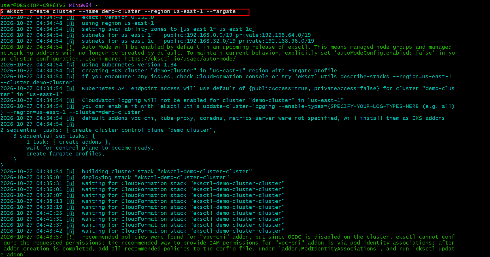
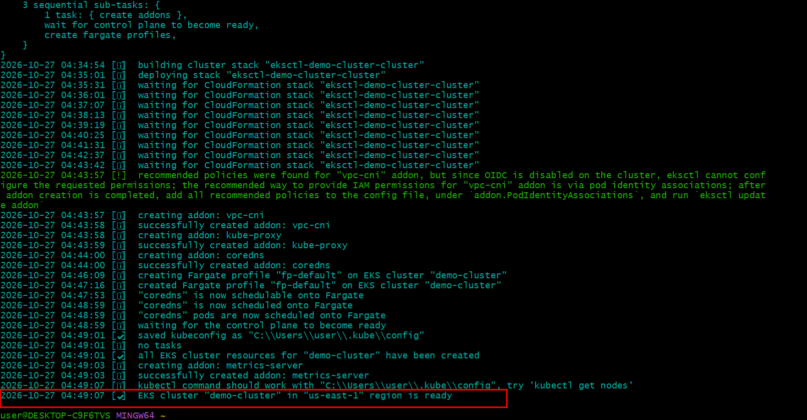

# 🎮 Deploying the 2048 Game on Amazon EKS with AWS Load Balancer Controller

## 📌 Project Overview

This project demonstrates how to deploy the 2048 browser game on Amazon Elastic Kubernetes Service (Amazon EKS) and expose it to external users through an AWS Application Load Balancer (ALB).

The project focuses on Kubernetes application deployment, AWS identity and access management, traffic routing with Ingress, and troubleshooting the AWS Load Balancer Controller.

A key part of this project was diagnosing and resolving a controller startup issue caused by a missing Kubernetes service account reference. This involved inspecting Kubernetes resources, investigating CloudFormation stack failures, recreating the service account with a different name, and redeploying the controller.

## 🎯 Project Objectives

- Deploy the 2048 game application on Amazon EKS.
- Understand Kubernetes Deployments, Pods, Services, and Ingress resources.
- Configure the AWS Load Balancer Controller to manage AWS load-balancing resources.
- Configure IAM permissions for the controller using an IAM policy, IAM role, and Kubernetes service account.
- Expose the application externally through an Application Load Balancer.
- Troubleshoot service-account and CloudFormation resource-creation failures.
- Document the deployment process and lessons learned.

## 🏗️ Architecture

The application is deployed on Amazon EKS, with the AWS Load Balancer Controller managing the Application Load Balancer based on Kubernetes Ingress configuration.

![2048 Game Deployment Architecture]


### Architecture components

| Component | Purpose |
|---|---|
| Amazon EKS | Provides the managed Kubernetes control plane. |
| AWS Fargate | Provides serverless compute capacity for supported Kubernetes Pods. |
| AWS Load Balancer Controller | Watches Kubernetes resources and configures AWS load balancers. |
| Application Load Balancer (ALB) | Receives external HTTP requests and routes traffic to the application. |
| Kubernetes Ingress | Defines the external routing rules for the application. |
| Kubernetes Service | Provides a stable endpoint and routes requests to the selected application Pods. |
| Kubernetes Deployment | Manages the desired number of application Pod replicas. |
| IAM policy and role | Provide AWS permissions to the load balancer controller through its service account identity. |

### Request flow

1. A user opens the 2048 game in a web browser.
2. The request reaches the Application Load Balancer over **HTTP**.
3. The ALB routes traffic according to its configured listener and routing rules.
4. The AWS Load Balancer Controller manages the ALB configuration based on the Kubernetes Ingress.
5. Traffic reaches the application Service and is forwarded to a healthy 2048 Pod.
6. The Pod serves the game interface to the user.

> **Note:** This project uses HTTP for application access. HTTPS and TLS certificate configuration are not included in the current implementation.

## 🛠️ Technologies and AWS Services

- **Amazon EKS** — managed Kubernetes
- **AWS Fargate** — serverless compute for Kubernetes Pods
- **AWS Application Load Balancer** — external application traffic
- **AWS Load Balancer Controller** — Kubernetes-to-AWS load balancer integration
- **AWS IAM** — roles and policies for controller permissions
- **AWS CloudFormation** — infrastructure resource provisioning through `eksctl`
- **Kubernetes** — Deployments, Pods, Services, Ingress, and service accounts
- **eksctl** — EKS cluster and IAM service-account management
- **AWS CLI** — AWS resource management from the terminal
- **kubectl** — Kubernetes cluster administration
- **Helm** — controller installation and package management, where applicable
- **Git and GitHub** — version control and project documentation

## ⚙️ Prerequisites

Before reproducing this deployment, ensure you have:

- An AWS account with appropriate permissions.
- An active Amazon EKS cluster.
- AWS CLI configured with the intended AWS identity.
- `kubectl` installed and configured for the cluster.
- `eksctl` installed.
- Helm installed if using Helm to deploy the controller.
- An IAM OIDC provider associated with the EKS cluster when using IAM Roles for Service Accounts (IRSA).
- The IAM permissions policy required by the AWS Load Balancer Controller.
- Kubernetes manifests for the 2048 application.

## 🚀 Implementation and Deployment

### 1. Configure access to the EKS cluster

Update the local Kubernetes configuration to connect to the cluster:

```bash
aws eks update-kubeconfig \
  --name demo-cluster \
  --region us-east-1
```

Verify connectivity:

```bash
kubectl get nodes
kubectl get pods -A
```

### 2. Prepare the IAM permissions policy

Download the IAM permissions document for the AWS Load Balancer Controller:

```bash
curl -O https://raw.githubusercontent.com/kubernetes-sigs/aws-load-balancer-controller/v2.11.0/docs/install/iam_policy.json
```

Create the IAM policy:

```bash
aws iam create-policy \
  --policy-name AWSLoadBalancerControllerIAMPolicy \
  --policy-document file://iam_policy.json
```

The policy defines the AWS API actions the controller requires to manage load-balancing resources. If the policy already exists, verify and reuse the appropriate version rather than attempting to create a duplicate.

### 3. Associate an IAM role with a Kubernetes service account

The controller needs AWS permissions to create and manage ALB resources. For an IRSA-based installation, an IAM role is associated with the Kubernetes service account.

The initial attempt used the following command:

```bash
eksctl create iamserviceaccount \
  --cluster=demo-cluster \
  --region=us-east-1 \
  --namespace=kube-system \
  --name=aws-load-balancer-controller \
  --role-name AmazonEKSLoadBalancerControllerRole \
  --attach-policy-arn=arn:aws:iam::<your-aws-account-id>:policy/AWSLoadBalancerControllerIAMPolicy \
  --approve
```

This attempt did not result in the expected service account being created. The issue was investigated through the Kubernetes resources and AWS CloudFormation console.

The corrected command used a different service account name:

```bash
eksctl create iamserviceaccount \
  --cluster=demo-cluster \
  --region=us-east-1 \
  --namespace=kube-system \
  --name=aws-load-balancer-controller-1 \
  --role-name AmazonEKSLoadBalancerControllerRole \
  --attach-policy-arn=arn:aws:iam::<your-aws-account-id>:policy/AWSLoadBalancerControllerIAMPolicy \
  --approve
```

Replace `<your-aws-account-id>` with the AWS account ID that owns the IAM policy.

**Important:** The service account name must match the `serviceAccountName` configured in the controller Deployment, and its IAM role annotation must reference the intended role. The example above documents the working name used in this project; verify it against your live configuration before reproducing the commands.

### 4. Install or recreate the AWS Load Balancer Controller

The AWS Load Balancer Controller watches Kubernetes Ingress resources and reconciles them with AWS load-balancing resources.

During troubleshooting, the existing controller Deployment was deleted and recreated after the service-account issue had been addressed.

For a Helm-based installation, ensure that the chart uses the intended service account and does not attempt to create a conflicting one. The chart's service-account settings should match the service account created by `eksctl`.

Verify the controller Deployment:

```bash
kubectl get deployment aws-load-balancer-controller \
  -n kube-system
```

Check its Pods:

```bash
kubectl get pods -n kube-system
```

Inspect controller logs if it fails to start:

```bash
kubectl logs deployment/aws-load-balancer-controller \
  -n kube-system
```

The controller must be running and able to assume its IAM role before it can successfully manage the required AWS resources.

### 5. Deploy the 2048 application

Apply the Kubernetes manifests for the application. The filenames below are examples; use the actual manifests stored in this repository.

```bash
kubectl apply -f https://raw.githubusercontent.com/kubernetes-sigs/aws-load-balancer-controller/v2.5.4/docs/examples/2048/2048_full.yaml
```
Verify the application resources:

```bash
kubectl get deployments,pods,services -A
kubectl get ingress -A
```

If your manifests use a dedicated namespace, use that namespace when checking the resources.

### 6. Verify ALB provisioning and application access

Inspect the Ingress resource:

```bash
kubectl describe ingress <your-ingress-name> \
  -n <your-namespace>
```

Check the Ingress address:

```bash
kubectl get ingress -A
```

The ALB hostname should appear in the Ingress address once provisioning and reconciliation have completed successfully.

Open the resulting ALB DNS hostname in a browser using HTTP, for example:

```text
http://<your-alb-dns-name>
```

Confirm that the 2048 game loads successfully.

## 🐛 Troubleshooting: AWS Load Balancer Controller Service Account

One of the main challenges encountered during this project was that the AWS Load Balancer Controller was not running as expected.

### Problem

After installing the controller, I checked the Kubernetes Pods and discovered that the controller was not running correctly.

I inspected the controller Deployment configuration using:

```bash
kubectl edit deployment aws-load-balancer-controller \
  -n kube-system
```

The investigation revealed that the Deployment referenced a Kubernetes service account that had not been created successfully.

### Investigation

I checked the AWS CloudFormation console and discovered that the CloudFormation stack associated with the initial `eksctl create iamserviceaccount` operation had failed.

The initial command had not produced the expected service account. The stack failure appeared to be related to conflicting resources from earlier attempts, although the original CloudFormation failure reason was not retained.

### Resolution

I took the following steps:

1. Deleted the failed CloudFormation stack.
2. Created a new IAM service account using the name `aws-load-balancer-controller-1`.
3. Verified the service-account configuration and ensured that the controller referenced the correct name.
4. Deleted and recreated the previous AWS Load Balancer Controller Deployment.
5. Checked the controller Pods again.
6. Confirmed that the controller started working and was able to create the required AWS load-balancing resources, including the ALB.

### Verification commands

These commands are useful when investigating a similar issue:

```bash
# Check the service account
kubectl get serviceaccount -n kube-system

# Inspect its IAM role annotation
kubectl describe serviceaccount \
  aws-load-balancer-controller-1 \
  -n kube-system

# Check controller Deployment readiness
kubectl get deployment aws-load-balancer-controller \
  -n kube-system

# Check controller Pods
kubectl get pods -n kube-system

# Inspect controller logs
kubectl logs deployment/aws-load-balancer-controller \
  -n kube-system

# Check application Ingress
kubectl get ingress -A
```

### Lessons learned

- A successful installation command should not be assumed to mean every required resource was created.
- Kubernetes service accounts and IAM roles are separate resources and must be correctly associated.
- The controller Deployment must reference the service account that actually exists.
- CloudFormation Events are important for identifying the underlying cause of failed `eksctl` operations.
- Existing IAM roles, service accounts, and CloudFormation stacks should be inspected before retrying resource creation.
- Recreating a Deployment can help apply corrected configuration, but the underlying IAM and service-account problem must be resolved first.
- Kubernetes status checks and controller logs are essential for validating that a deployment is healthy.

## 📸 Project Screenshots

Screenshots provide evidence of the resources and application running successfully.






## 🎥 Project Demo

Watch the 2048 game running on Amazon EKS:

[▶️ Watch the deployment demo](https://github.com/user-attachments/assets/00e326a7-b06f-43cb-936e-bde21b54aa53)